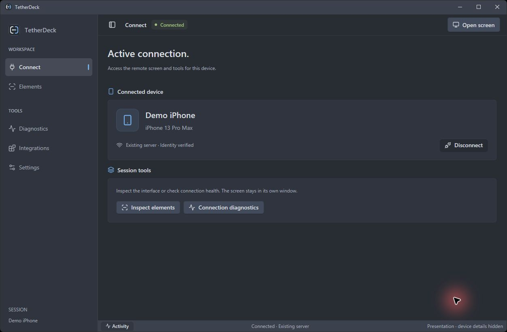

# TetherDeck

[Português](README.pt-BR.md) · [Español](README.es.md)


[](https://github.com/rafagouveia/TetherDeck/releases/download/v0.1.0-preview.1/tetherdeck-windows-x86_64.zip)

**Download → extract the ZIP → open `TetherDeck.exe`.** Keep the files together.
[Release notes and SHA-256](https://github.com/rafagouveia/TetherDeck/releases/tag/v0.1.0-preview.1) · [Setup requirements](docs/GETTING-STARTED.en.md)

Requires Apple's Windows device support, trusted pairing and external FFmpeg for video.

**A native Windows workspace for connecting to, viewing and automating an iPhone.**

TetherDeck brings a live device screen, touch controls, element inspection and
connection diagnostics into one Rust application. It is free, open source and
currently focused on Windows. The project is an experimental preview; device and
iOS compatibility are still being expanded.

## See TetherDeck

Real captures; device names and identifiers are hidden.
GIFs use sampled frames and shortened pauses; FPS and latency require separate measurements.



[Open the workspace screenshot](docs/media/workspace.jpg).

<details>
<summary>Watch a short tour of navigation and settings</summary>


[Open the animated tour](docs/media/workflow.gif).

</details>

### Live remote window

The iPhone screen stays in its own window, alongside the device controls.

<p align="center">
  
</p>

[Open the remote window screenshot](docs/media/remote-screen.jpg).

<details>
<summary>Watch a real interaction: 2 + 2 = 4 in Calculator</summary>


[Open the remote interaction clip](docs/media/remote-control.gif).

</details>

### Inspect by element

Find controls by name or accessibility identifier. Here, Calculator's `AllClear`
key is selected from a real WDA snapshot.


[Open the element inspector screenshot](docs/media/elements.jpg).

## What you can do

| Workflow | Available capability |
| --- | --- |
| View and control | Independent transparent phone window, live HEVC preview, continuous mouse touch, Home, app switcher, volume and lock controls. |
| Automate by element | Inspect accessibility identifiers and hierarchy, find elements and activate them through a configured WebDriverAgent runner. |
| Diagnose connections | Inspect Apple service, USB/usbmux, pairing and transport evidence; perform explicitly enabled recovery operations. |
| Connect your tools | Shared Rust client, authenticated HTTP API, CLI and optional MCP stdio adapter for automation tools and AI agents. |
| Use Wi-Fi | Separate Apple/usbmux Wi-Fi, direct paired Wi-Fi and existing local RSD tunnel workflows. Availability depends on pairing and the selected transport. |

The desktop supports system/Portuguese/English/Spanish language selection,
light/dark/system appearance and reduced motion. Device names and accessibility
content remain as supplied by the device.

## Start on Windows

1. Install Apple's Windows device support and establish a trusted USB pairing.
2. Provide an external FFmpeg executable with HEVC decoding for the live window.
3. Open **TetherDeck.exe**, choose a transport, discover your iPhone and open a session.
4. Choose **Open screen** for the independent phone window, or use **Elements**,
   **Diagnostics** and **Integrations** in the workspace.

Keep the packaged executables together. A local desktop session starts its own
scoped daemon and keeps its temporary API token in memory.

For FFmpeg, set `TETHERDECK_FFMPEG`, put `ffmpeg.exe` beside the app, install it at
`%ProgramFiles%\ffmpeg\ffmpeg.exe`, or make it available on `PATH`, in that order.
FFmpeg is not bundled or downloaded automatically.

**Guides:** [English](docs/GETTING-STARTED.en.md) ·
[Português](docs/GETTING-STARTED.md) · [Español](docs/GETTING-STARTED.es.md)

### Build from source

Requirements: Windows x86_64, Rust stable with the MSVC toolchain, Visual Studio
C++ build tools/Windows SDK, and a DirectX 11 capable graphics environment.

```powershell
cargo check --locked --workspace
cargo build --release --locked -p tetherdeck-desktop -p rust-ios-device-daemon -p rust-ios-device -p rust-ios-device-mcp
.\target\release\tetherdeck-desktop.exe
```

To create a local Windows archive:

```powershell
.\scripts\package-windows.ps1 -BinariesDirectory .\target\release
```

The package script uses an explicit file list. Development recordings, signing
materials, pairing records and personal runner packages are excluded.

## Element automation and your certificate

Element automation requires a compatible WebDriverAgent XCTest runner signed and
provisioned for **your own device and Apple development team**. The Windows desktop
itself does not require an Apple signing certificate.

Import a pre-signed `.ipa`, review its metadata and explicitly install it over
paired USB. A `.cer` alone cannot sign a runner: signing also needs the matching
private key and provisioning profile, plus a compiled runner. TetherDeck does not
collect your private key, signing password or Apple login, and does not compile
Xcode projects on Windows. No personal certificate or runner is distributed.

See [runner preparation and import](docs/RUNNER-IMPORT.md). Local preflight checks
structure and metadata; iOS performs final signature validation during installation.

Element inspection can explicitly use native iOS AX (read-only traversal) or WDA.
AX does not need a WDA certificate. Isolated Wi-Fi WDA requires a compatible runner
and an explicit binding review for its exact Bundle ID. See [element providers](docs/ELEMENT-PROVIDERS.md).

## Wi-Fi and performance

Initial USB trust/preparation may be necessary before using Wi-Fi. After the
required pairing exists, supported network workflows operate without the cable.
Direct paired Wi-Fi and an RSD tunnel are different connections; TetherDeck does
not create an external RSD tunnel automatically. WDA element availability is
reported separately from live video and touch support.

The live preview is downscaled before RGBA conversion, while input coordinates
remain in physical device pixels. Mouse contact starts when pressed, updates while
moving and releases when let go. Unsent positions are coalesced. Failed device
mutations are not automatically replayed after reconnection.

The statistics panel reports distinct frames painted by GPUI, a derived frame
interval, local frame age and API response time. These do not measure display
presentation or end-to-end interaction latency. **30/60 FPS are performance goals,
not a guarantee for every device, network or graphics driver.**

Linux CLI/backend sources and an older egui desktop remain in the workspace.
The current product and release effort focus on the Windows GPUI desktop.

## Architecture and trust

The GUI, CLI and MCP adapter share the same versioned API and client. The daemon
runs near the device, binds to loopback and requires a bearer token. Use SSH
forwarding for remote API access; do not expose the plaintext HTTP listener publicly.

Read [architecture](docs/ARCHITECTURE.md), [security](SECURITY.md),
[third-party notices](docs/THIRD-PARTY.md) and the
[publication checklist](docs/PUBLICATION-CHECKLIST.md).

## Contribute

Bug reports, connection diagnostics, UI feedback, translations, documentation and
Rust contributions are welcome. English, Portuguese and Spanish reports are welcome.
Please redact device identifiers, addresses, tokens and screen content before posting.

- [Open an issue](https://github.com/rafagouveia/TetherDeck/issues)
- [Contribution guide](CONTRIBUTING.md)
- [Community conduct](CODE_OF_CONDUCT.md)

If repository Discussions is enabled, use it for open-ended design and usage topics.
This is an independent community project, not an Apple product.

## License

TetherDeck's original code and artwork are [MIT licensed](LICENSE).
Vendored libraries and other dependencies retain their own licenses and notices;
see [third-party attribution](docs/THIRD-PARTY.md).
