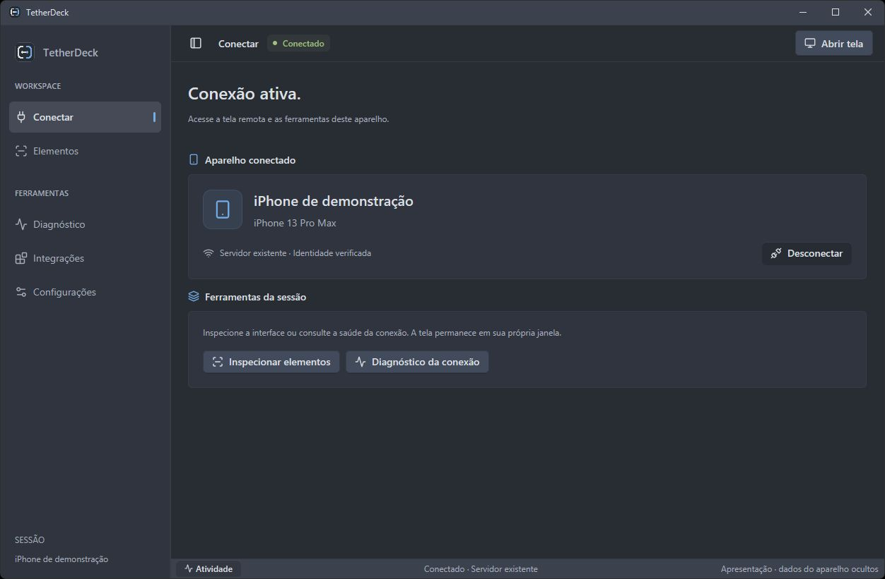
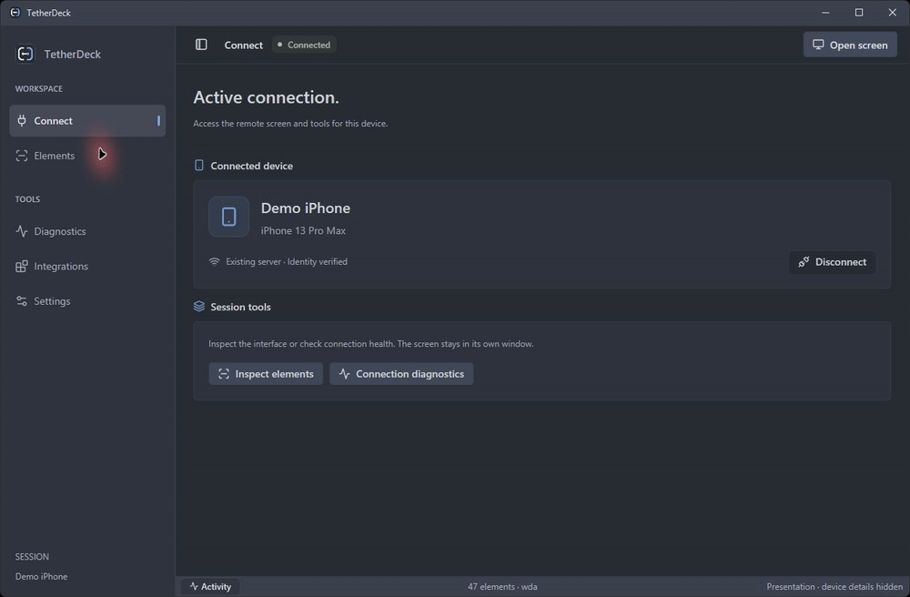
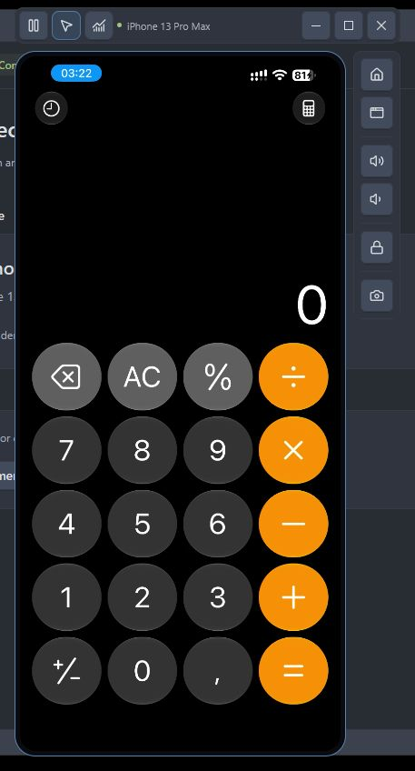
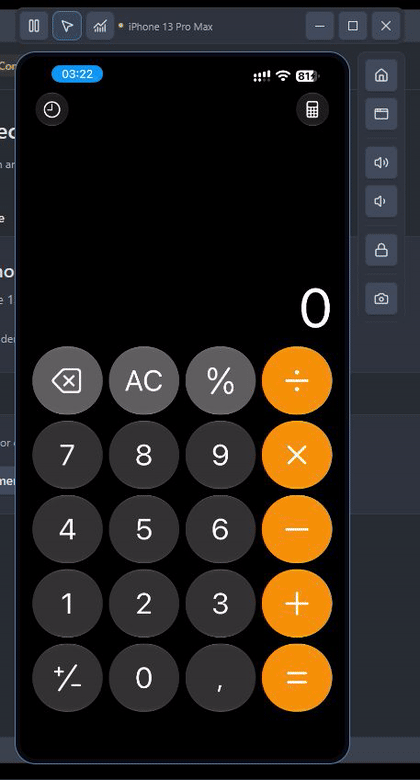
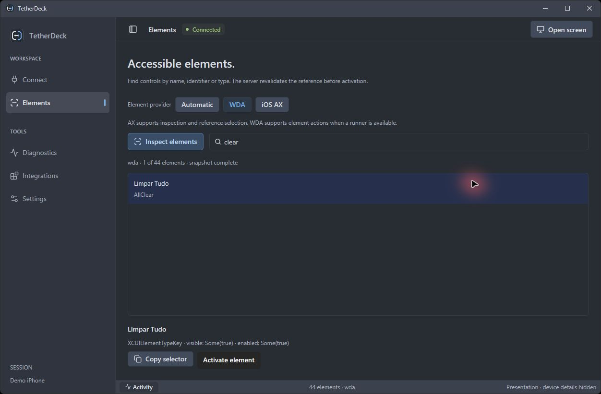

# TetherDeck

[English](README.md) · [Español](README.es.md)

**Baixe → extraia o ZIP → abra `TetherDeck.exe`.** Mantenha os arquivos juntos.
[Notas da versão e SHA-256](https://github.com/rafagouveia/TetherDeck/releases/tag/v0.1.0-preview.1) · [Preparar o computador](docs/GETTING-STARTED.md)

Requer suporte Apple no Windows, pareamento confiável e FFmpeg externo para vídeo.

**Um espaço de trabalho nativo para conectar, visualizar e automatizar um iPhone pelo Windows.**

Projeto gratuito e open source em Rust, atualmente em prévia experimental com foco
no Windows. Reúne tela ao vivo em janela independente, toque contínuo pelo mouse,
controles do aparelho, inspeção por elementos e diagnóstico de conexão.

## Conheça o TetherDeck

Capturas reais; nomes e identificadores do aparelho ocultos.
Os GIFs usam quadros amostrados e pausas encurtadas; FPS e latência exigem medição separada.

[Abrir a captura da interface](docs/media/workspace.pt-BR.jpg).

Ver um tour breve da navegação e das configurações

[Abrir o tour animado](docs/media/workflow.gif).

### Tela remota ao vivo

A tela do iPhone fica em uma janela independente, ao lado dos controles do aparelho.

  

[Abrir a captura da janela remota](docs/media/remote-screen.jpg).

Ver uma interação real: 2 + 2 = 4 na Calculadora

[Abrir o clipe de interação remota](docs/media/remote-control.gif).

### Inspeção por elemento

Encontre controles pelo nome ou identificador de acessibilidade. Aqui, a tecla
`AllClear` da Calculadora está selecionada em uma captura real do WDA.

[Abrir a captura do inspetor de elementos](docs/media/elements.jpg).

## Começar

1. Instale o suporte de dispositivos Apple no Windows e estabeleça o pareamento USB.
2. Disponibilize FFmpeg externo com decodificação HEVC para a tela ao vivo.
3. Abra **TetherDeck.exe**, escolha o transporte, busque o iPhone e abra uma sessão.
4. Use **Abrir tela**, **Elementos**, **Diagnóstico** e **Integrações**.

Mantenha os executáveis do pacote na mesma pasta. Idioma, aparência, movimento
reduzido e descoberta automática podem ser ajustados na interface.

Consulte o [guia de início](docs/GETTING-STARTED.md), os
[requisitos do runner](docs/RUNNER-IMPORT.md) e a [arquitetura](docs/ARCHITECTURE.md).
As instruções completas de compilação estão no [README principal](README.md#build-from-source).

## Certificado e Wi-Fi

O aplicativo Windows não precisa de certificado Apple. A automação por elementos
usa um runner WebDriverAgent assinado pela sua equipe para seus aparelhos.
Cada pessoa fornece seu próprio IPA: o certificado pessoal do autor não é distribuído.
Um `.cer` sozinho não assina um app. A importação não recebe chave privada, senha
ou login Apple; o iOS confirma a assinatura durante a instalação por USB pareado.

O Wi-Fi pode exigir preparação inicial pelo USB. Wi-Fi Apple/usbmux, Wi-Fi direto
pareado e túnel RSD são caminhos distintos, com capacidades próprias. Um túnel
externo já deve existir quando essa opção for escolhida.

FPS de pintura, idade local do quadro e resposta da API são mostrados separadamente.
Eles não medem latência completa. 30/60 FPS são metas de desempenho e dependem do
aparelho, rede e computador. O foco atual é o desktop GPUI no Windows.

## Comunidade

Envie dúvidas, problemas e sugestões em [Issues](https://github.com/rafagouveia/TetherDeck/issues).
Relatos em português, inglês ou espanhol são bem-vindos. Remova tokens, UDIDs,
endereços e conteúdo pessoal de imagens e diagnósticos antes de publicar.

Veja [como contribuir](CONTRIBUTING.md), [conduta](CODE_OF_CONDUCT.md),
[segurança](SECURITY.md) e [licenças de terceiros](docs/THIRD-PARTY.md).
Código e identidade visual originais sob [MIT](LICENSE).
